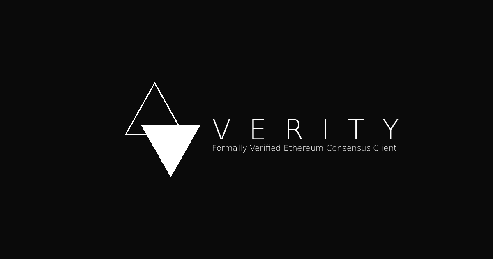

# Verity

<p align="center">
  <a href="https://verityclient.com">
    
  </a>
</p>

<p align="center">
  <strong>The Provable Consensus Client</strong><br>
  An Ethereum Lean Consensus client by <a href="https://github.com/NyxFoundation">Nyx Foundation</a>.
</p>

<p align="center">
  <a href="https://github.com/NyxFoundation/verity/actions/workflows/rust.yml"></a>
  <a href="https://github.com/NyxFoundation/verity/actions/workflows/quality.yml"></a>
  <a href="https://github.com/NyxFoundation/verity/actions/workflows/docs.yml"></a>
  <a href="./LICENSE"></a>
</p>

> [!WARNING]
> Verity is experimental software under active development. It is not ready for production use.

## What is Verity?

Verity is a full node for Ethereum's
[Lean Consensus](https://leanroadmap.org/) roadmap. It combines a Rust runtime with the
[formal-leanSpec](https://github.com/NyxFoundation/formal-leanSpec) Lean 4 model, progressively
moving stable consensus logic behind a small, proven interface.

The current execution path is Rust-first: consensus behavior is checked against
[leanSpec](https://github.com/leanEthereum/leanSpec) fixtures and covered by property tests and
bounded model checking. Lean-compiled implementations will replace matching Rust capabilities as
they become proved, stable, and fast enough. This keeps the project usable while making the
verification boundary explicit rather than claiming that unverified runtime code is already
proven.

## Current implementation

Verity currently includes:

- state transition, fork choice, proposer selection, and validator duties;
- post-quantum XMSS signing and verification through
  [leanSig](https://github.com/leanEthereum/leanSig), plus aggregate proofs through
  [leanVM](https://github.com/leanEthereum/leanVM);
- QUIC networking with gossipsub and request/response protocols;
- RocksDB persistence, checkpoint sync, and proof retention;
- the cross-client `/lean/v0` HTTP API and Prometheus metrics; and
- differential tests against production-scheme leanSpec fixtures and Kani harnesses for
  Verity-owned decision logic.

See the [architecture](./docs/src/reference/architecture.md) for the trust boundaries and crate
layout.

## Build from source

The pinned Rust toolchain is installed automatically by `rustup`. A C++ toolchain and `libclang`
are also required because RocksDB is compiled from source; see the
[host build requirements](./CONTRIBUTING.md#host-build-requirements) for platform details.

```bash
git clone https://github.com/NyxFoundation/verity.git
cd verity
cargo build --release --locked --bin verity
./target/release/verity --help
```

`Cargo.lock` is part of the build contract, so use `--locked` rather than re-resolving the git
dependencies.

## Run a node

Verity accepts the same genesis, bootnode, node-key, and validator-key formats generated by
[lean-quickstart](https://github.com/blockblaz/lean-quickstart). A non-validating node can be
started with:

```bash
./target/release/verity \
  --genesis /path/to/config.yaml \
  --bootnodes /path/to/nodes.yaml \
  --node-key /path/to/node.key \
  --api-port 5052 \
  --metrics-port 5054
```

Pass `--validator-keys` and `--node-id` to run assigned validator duties. Use `verity --help` for
the complete configuration surface. A published container image is available from
[`ghcr.io/nyxfoundation/verity`](https://github.com/NyxFoundation/verity/pkgs/container/verity).

## Development

Run the default local test suite with:

```bash
cargo test --locked --workspace
```

Production-scheme fixture and signing tests run in CI; locally they activate when
`VERITY_FIXTURES` and `VERITY_TEST_KEYS` point to extracted test data. See
[CONTRIBUTING.md](./CONTRIBUTING.md) for host dependencies, pre-commit setup, and the full check
matrix.

## Documentation

User-facing documentation is published at
[docs.verityclient.com](https://docs.verityclient.com). Internal design records covering the
domain model, concurrency, sync, storage, key management, and verification tooling live in
[`docs/design/`](./docs/design/). Aeneas-generated Lean and its correspondence proofs against
formal-leanSpec live in
[`verity-aeneas-proofs`](https://github.com/NyxFoundation/verity-aeneas-proofs).

## Acknowledgments

Verity does not start from zero. It builds on a young, fast-moving ecosystem of Lean Consensus
implementations whose authors did the hard work of turning a moving specification into running
clients — and Verity has learned from every one of them.

[ethlambda](https://github.com/lambdaclass/ethlambda) by LambdaClass is a study in disciplined
minimalism: a clean-slate, consensus-only client that carries post-quantum, hash-based signatures
into the production path from day one and refuses to accumulate the complexity Lean Ethereum was
designed to shed. Keeping the surface that small is exactly the spirit a tractable proof needs.

[ream](https://github.com/ReamLabs/ream) by ReamLabs sets a high bar for engineering breadth — a
Beacon/Lean dual stack, zkVM-friendly cryptography, serious networking, and a tooling and CI
discipline worth imitating. Its habit of expressing collection bounds in the type, rather than
checking them at runtime, is precisely the kind of invariant Verity wants inside its verified core.

Verity makes a different bet — that the implementation should be proven to match the specification,
not only tested against it — but that bet is worth making only because these clients have already
shown what a good Lean Consensus client looks like. We are grateful to their authors and to the
wider [Lean Ethereum](https://leanroadmap.org/) community.

## License

[MIT](./LICENSE) © Nyx Foundation
